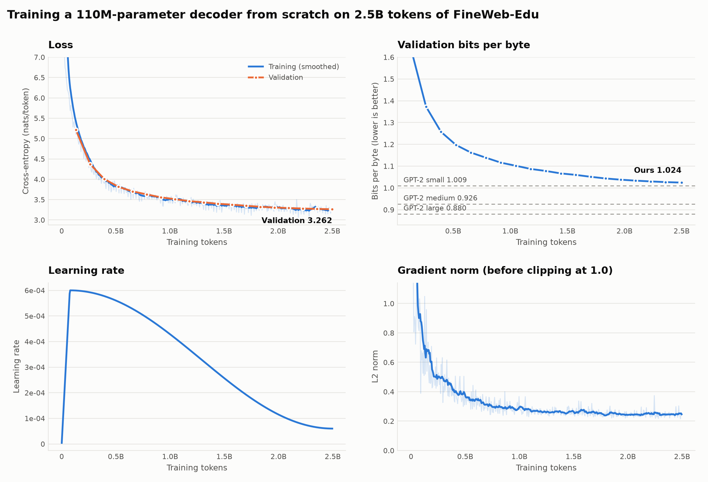
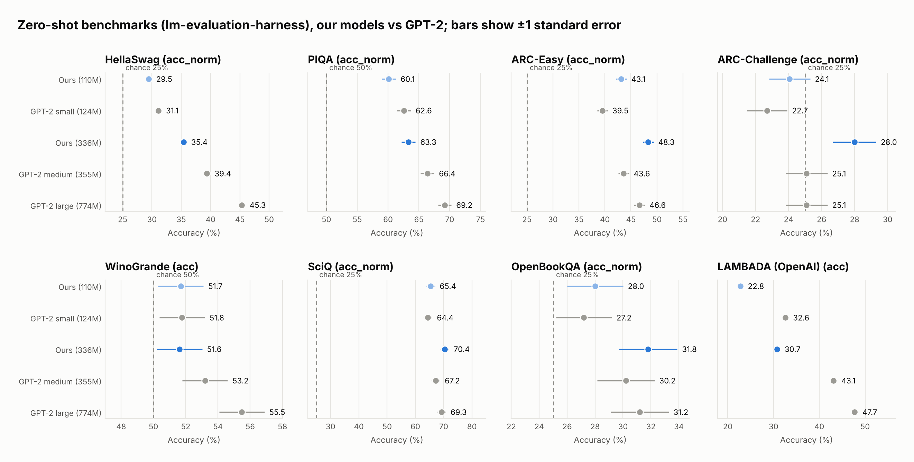

# Decoder-Only Transformer from Scratch

A GPT-style language model built from scratch, tokenizer included, and trained at two sizes (110M and 336M parameters) on FineWeb-Edu with two GPUs, then evaluated against GPT-2.

> *In my earlier projects, like LinkLens-V2 and FACTIFY, I used transformer models through libraries, and I always wanted to understand how they actually work underneath. So instead of using the libraries as they are, I built every part from scratch, from the tokenizer to the evaluation, and trained it at two sizes.*

**📄 [Technical report (PDF)](docs/technical_report.pdf)**: the full architecture, data, training and evaluation details.

**✍️ [Blog series](https://yashksingh.hashnode.dev/)**: the learning journey behind it, one post per stage, from tokenization to evaluation.

## Results at a glance

| | 110M | 336M |
|---|---|---|
| Layers × d_model | 12 × 768 | 24 × 1,024 |
| Training data | 2.5B tokens of FineWeb-Edu | 7.0B tokens of FineWeb-Edu |
| Training time on 2× A30 | ≈ 4.6 h at 35% MFU | ≈ 34.7 h at 39% MFU |
| Held-out FineWeb-Edu, bits/byte ↓ | **1.000** (GPT-2 small: 1.009) | **0.897** (GPT-2 medium: 0.926; large: 0.880) |
| 8-task zero-shot average ↑ | 40.6 (GPT-2 small: 41.5) | 44.9 (GPT-2 medium: 46.0) |

- On text like their training data, both models beat the size-matched GPT-2, and the 336M comes within 0.017 bits/byte of GPT-2 large, a model 2.3× its size.
- On science and school-knowledge benchmarks (ARC-Easy, ARC-Challenge, SciQ, OpenBookQA), both beat the size-matched GPT-2, and the 336M beats GPT-2 large on all four.
- They are weaker on narrative and general text: behind GPT-2 on Wikipedia, books and C4, on HellaSwag, PIQA and WinoGrande, and 9–11 points behind on LAMBADA.

The pattern follows the data: FineWeb-Edu is filtered for educational content, which buys knowledge and in-domain modelling at the cost of breadth.





More charts and every number are in [`results/`](results/) and the [report](docs/technical_report.pdf).

## What's built from scratch

Everything except PyTorch's tensor operations and its fused attention kernel:

| Component | File |
|---|---|
| Byte-level BPE tokenizer (32,768 tokens) | [`Tokenizer/byte_level_bpe.py`](Tokenizer/byte_level_bpe.py) |
| Token embeddings, Q/K/V projections | [`Embedding/embeddings.py`](Embedding/embeddings.py) |
| Rotary position embeddings (RoPE) | [`Positional_Encoding/rotary_positional_encoding.py`](Positional_Encoding/rotary_positional_encoding.py) |
| Multi-head causal attention with KV cache | [`Attention_Mechanism/multi_head_causal_attention.py`](Attention_Mechanism/multi_head_causal_attention.py) |
| LayerNorm | [`LayerNorm/layer_norm.py`](LayerNorm/layer_norm.py) |
| Feed-forward network (GELU) | [`FeedForward_Network/ffn.py`](FeedForward_Network/ffn.py) |
| Pre-LN decoder block, full model (weight tying, GPT-2-style init) | [`Decoder_Blocks/`](Decoder_Blocks/) |
| Distributed training (DDP, bf16, torch.compile) | [`train.py`](train.py) |
| Evaluation against GPT-2 | [`evaluate.py`](evaluate.py), [`domain_eval.py`](domain_eval.py), [`harness_eval.py`](harness_eval.py), [`context_eval.py`](context_eval.py) |

Every component has its own tests in [`tests/`](tests/). They check behaviour, not just shapes: matching PyTorch's reference implementations and their gradients, RoPE's relative-position property, causality, and that cached generation matches a full pass.

## Repository layout

```
Tokenizer/              tokenizer, its training and dataset tokenization, tokenizer.json
Embedding/  Positional_Encoding/  Attention_Mechanism/
FeedForward_Network/  LayerNorm/  Decoder_Blocks/      the model
tests/                  one test file per component; run_all.py runs the suite
train.py, run_336m.sh   training
evaluate.py, domain_eval.py, harness_eval.py, context_eval.py, check_kv_cache.py   evaluation
plot_results.py, export_artifacts.py, check_data.py    charts, model export, data checks
results/                evaluation reports (JSON and Markdown) and charts
logs/                   training logs, console output and run summaries of both models
docs/                   technical report (PDF) and its LaTeX source
```

## Quick start

```bash
pip install -r requirements.txt

# Run the test suite (CPU is fine, about a minute)
python -m tests.run_all
```

### Reproducing the models

```bash
# 1. Tokenize FineWeb-Edu (2.5B tokens; add --resume with --max-tokens 7e9 to extend to 7B)
python Tokenizer/tokenize_dataset.py --tokenizer Tokenizer/tokenizer.json --out-dir data --max-tokens 2.5e9

# 2. Train the 110M (script defaults, 2 GPUs)
torchrun --standalone --nproc_per_node=2 train.py --compile

# 3. Train the 336M
bash run_336m.sh

# 4. Evaluate against GPT-2 and draw the charts
python evaluate.py
python domain_eval.py
python harness_eval.py
python context_eval.py
python check_kv_cache.py --label after
python plot_results.py
```

The tokenizer itself is already trained ([`Tokenizer/tokenizer.json`](Tokenizer/tokenizer.json)); [`Tokenizer/train_tokenizer.py`](Tokenizer/train_tokenizer.py) retrains it from a FineWeb-Edu sample.

## Model weights and data

- Model checkpoints: [Kevhand/decoder-110m](https://huggingface.co/Kevhand/decoder-110m) and [Kevhand/decoder-350m](https://huggingface.co/Kevhand/decoder-350m) (the 336M model) on the Hugging Face Hub.
- Tokenized training shards: [Kevhand/fineweb-edu-32k-tokenized](https://huggingface.co/datasets/Kevhand/fineweb-edu-32k-tokenized).

## References

The main works this project builds on, with full citations in the [report](docs/technical_report.pdf):

- Vaswani et al., *Attention Is All You Need*, 2017
- Radford et al., *Language Models are Unsupervised Multitask Learners* (GPT-2), 2019
- Su et al., *RoFormer: Enhanced Transformer with Rotary Position Embedding*, 2021
- Penedo et al., *The FineWeb Datasets*, 2024
- Hoffmann et al., *Training Compute-Optimal Large Language Models* (Chinchilla), 2022
- EleutherAI, *lm-evaluation-harness*

## License

[MIT](LICENSE)
